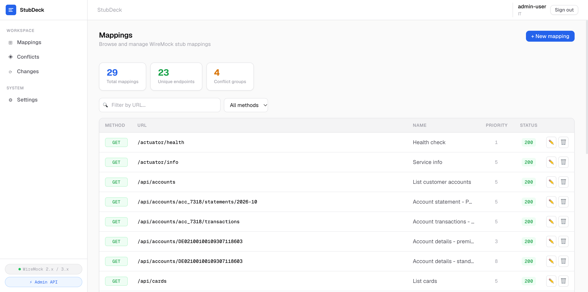
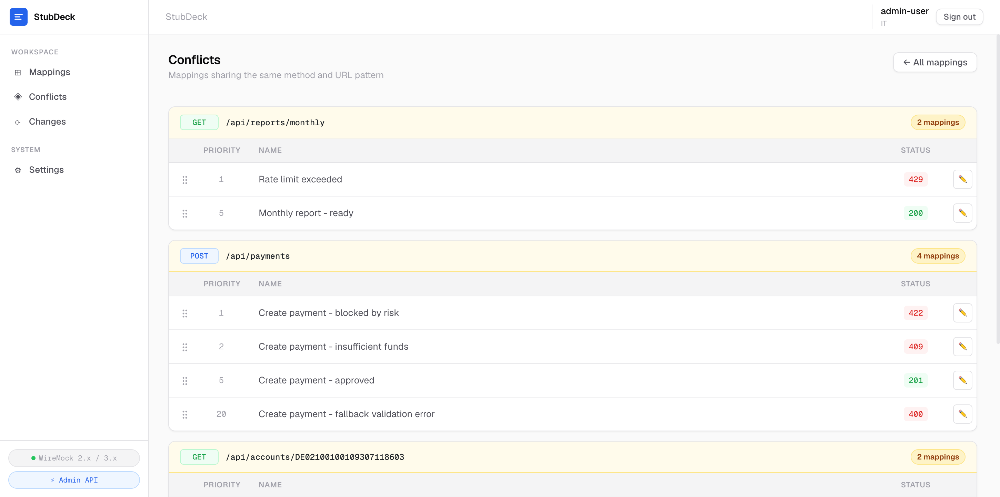
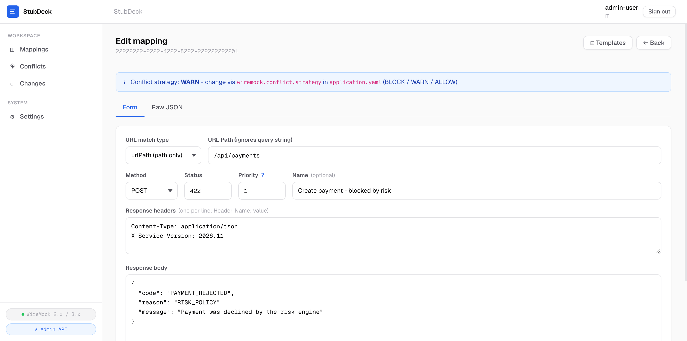
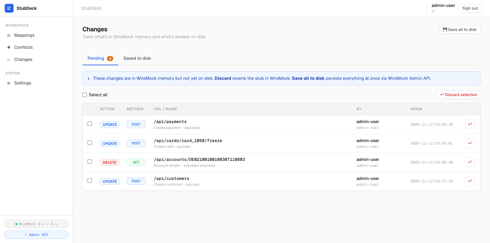

# StubDeck

A management UI for WireMock environments.

StubDeck helps developers manage mappings, inspect potentially conflicting stubs, control priorities, edit mappings
safely, track changes, and understand the state of a shared WireMock instance.

[Русская версия](README_RU.md)

## Why StubDeck?

WireMock is easy to manage when you have a few mappings and one developer.

Things become harder when the same WireMock instance is shared by a team:

- mappings grow into hundreds or thousands of JSON files;
- several mappings may target the same endpoint;
- priorities become difficult to understand;
- developers can overwrite changes made by someone else;
- runtime changes may differ from persisted state;
- it becomes difficult to understand who changed what.

StubDeck adds a management layer around WireMock without replacing it.

## Screenshots

### Mappings



### Conflicts



### Mapping editor



### Changelog



## Features

- Browse and search WireMock mappings
- Filter mappings by HTTP method and URL
- Detect potentially conflicting mappings
- Manage WireMock priorities
- Edit mappings using a form or raw JSON
- Validate mapping JSON before saving
- Use templates for common stub scenarios
- Protect pending changes from being overwritten by another user
- Track CREATE, UPDATE, and DELETE operations
- See whether runtime changes have been persisted
- Save or discard pending changes
- Work with mappings through the file system or WireMock Admin API

## How it works

StubDeck does not proxy mocked traffic and does not replace WireMock.

It acts as a management layer around an existing WireMock setup.

## Deployment model

> [!IMPORTANT]
> StubDeck currently supports a single application replica. Horizontal scaling is not supported yet.

Pending changes and their ownership are kept in application memory and persisted to a local state file. The changelog is
also stored locally. Running multiple StubDeck replicas would therefore create independent state and inconsistent change
ownership between replicas.

For this reason, run exactly one StubDeck replica per deployment.

Multi-replica support is planned. It will require shared or external state storage and coordination between replicas.

A production container image for StubDeck itself is not included yet. The Docker Compose files in this repository are
intended for the local WireMock and LDAP development environment.

## Quick Start

### Requirements

- Java 25
- Docker with Docker Compose for the local WireMock and LDAP environment

Gradle does not need to be installed separately. The project uses Gradle Wrapper 9.4.1.

StubDeck is currently tested with WireMock 3.13.2. Other WireMock 3.x versions may work but are not yet part of the
compatibility test matrix.

### Start local WireMock

```bash
   docker compose -f docker-compose/wiremock-docker.yaml up -d
```

The development Compose file starts two WireMock instances:

- `http://localhost:8091`
- `http://localhost:8093`

The checked-in application configuration currently connects StubDeck to the first instance on port `8091`.

### Start local LDAP

```bash
   docker compose -f docker-compose/ldap-docker.yaml up -d
```

phpLDAPadmin is available at `http://localhost:8092`.

The LDAP users under `docker-compose/ldap-seed` are development-only test accounts.

### Build

macOS / Linux:

```bash
   ./gradlew clean build
```

Windows:

```bat
   gradlew.bat clean build
```

### Run

```bash
   ./gradlew :app:bootRun
```

Open:

```text
   http://localhost:8090
```

### Run tests

```bash
   ./gradlew test
```

## Configuration

The main settings use the `wiremock.*` prefix.

| Property                                 | Description                                          |             Code default |    Checked-in dev config |
|------------------------------------------|------------------------------------------------------|-------------------------:|-------------------------:|
| `wiremock.source.type`                   | Mapping source: `FILE` or `API`                      |                   `FILE` |                    `API` |
| `wiremock.mappings.path`                 | Path to mapping JSON files in `FILE` mode            |             `./mappings` |             `./mappings` |
| `wiremock.conflict.strategy`             | Conflict behavior: `BLOCK`, `WARN`, or `ALLOW`       |                   `WARN` |                   `WARN` |
| `wiremock.changelog.path`                | Local changelog file                                 |        `./changelog.log` |        `./changelog.log` |
| `wiremock.pending.path`                  | Local pending-change state file                      | `./pending-changes.json` | `./pending-changes.json` |
| `wiremock.admin.scheme`                  | WireMock Admin API scheme                            |                   `http` |                   `http` |
| `wiremock.admin.host`                    | WireMock Admin API host                              |              `localhost` |              `localhost` |
| `wiremock.admin.port`                    | WireMock Admin API port                              |                   `8080` |                   `8091` |
| `wiremock.admin.username`                | Optional Basic Auth username                         |                    empty |                    empty |
| `wiremock.admin.password`                | Optional Basic Auth password                         |                    empty |                    empty |
| `wiremock.admin.connect-timeout-seconds` | Admin API connection timeout                         |                      `5` |                      `5` |
| `wiremock.admin.read-timeout-seconds`    | Admin API read timeout                               |                     `30` |                     `30` |
| `wiremock.admin.api-limit`               | Maximum number of mappings loaded from Admin API     |                  `10000` |                  `10000` |
| `wiremock.auth.enabled`                  | Enable StubDeck authentication                       |                  `false` |                   `true` |
| `wiremock.auth.provider-type`            | Authentication provider: `NONE`, `MEMORY`, or `LDAP` |                   `NONE` |                   `LDAP` |

`OAUTH2` is reserved in the current configuration model but is not implemented as an authentication provider yet.

The checked-in `application.yaml` is a local development configuration. Do not reuse its LDAP credentials in a
production deployment.

## Current limitations

- StubDeck must currently run as a single replica.
- One WireMock instance is managed at a time.
- Multi-instance management is not available yet.
- A production Docker image for StubDeck is not provided yet.
- OAuth2 authentication is not implemented yet.

## Roadmap

Planned areas of development:

- multiple WireMock instances;
- multi-replica StubDeck deployments;
- change sets and diffs;
- rollback;
- advanced change history;
- environment switching;
- OAuth2 authentication;
- improved team workflows.

### Multi-replica deployment

Future versions are planned to support multiple StubDeck replicas.

This requires:

- external or shared state storage;
- coordination of concurrent changes;
- distributed locking where required;
- consistent change state across replicas.

## Editions

StubDeck Community is the open-source edition of the project.

The core WireMock management experience will remain available in the Community edition.

Additional team and enterprise capabilities may be introduced in future commercial editions.

## Contributing

Contributions are welcome. See [CONTRIBUTING.md](CONTRIBUTING.md).

## Security

Please do not report security vulnerabilities through public GitHub issues.

See [SECURITY.md](SECURITY.md).

## License

StubDeck Community Edition is licensed under the Apache License 2.0.

See [LICENSE](LICENSE).

## WireMock

StubDeck is an independent project and is not affiliated with or endorsed by the WireMock project.

WireMock is referenced only to describe compatibility and integration with the WireMock software.
