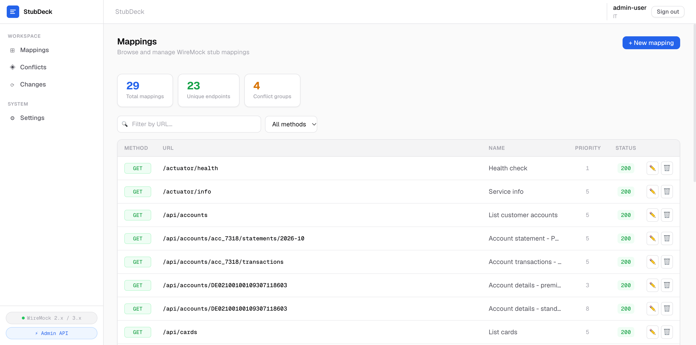
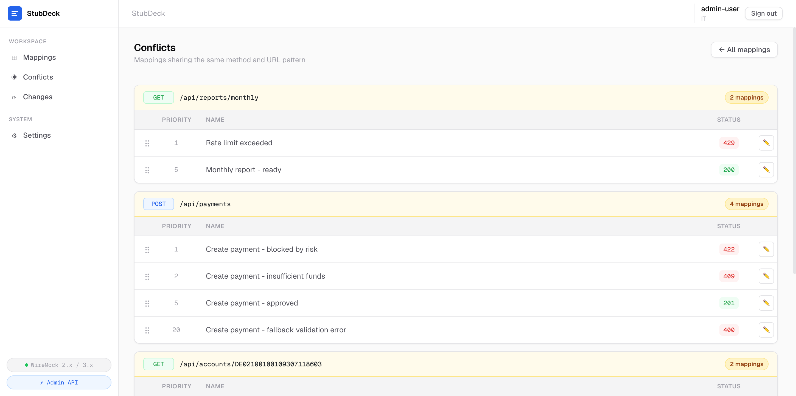
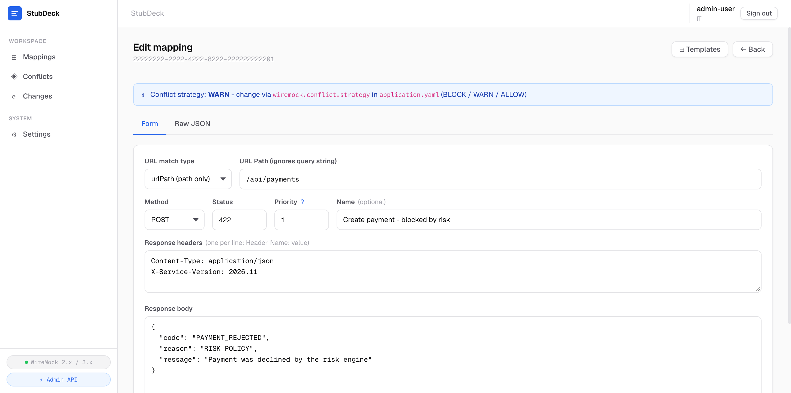
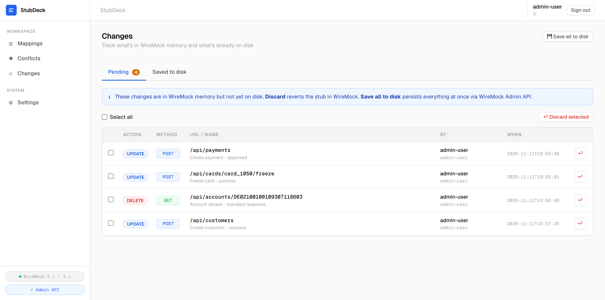

# StubDeck

Веб-интерфейс для управления окружениями WireMock.

StubDeck помогает разработчикам управлять mappings, находить потенциально конфликтующие стабы, настраивать приоритеты,
безопасно редактировать mappings, отслеживать изменения и понимать текущее состояние общего WireMock-инстанса.

[English version](README.md)

## Зачем нужен StubDeck?

WireMock легко использовать, пока mappings немного и с ними работает один разработчик.

При работе команды появляются другие задачи:

- количество JSON mappings растет до сотен и тысяч;
- несколько mappings могут относиться к одному endpoint;
- становится сложнее понимать приоритеты;
- один разработчик может перезаписать изменения другого;
- runtime-состояние может отличаться от сохраненного;
- сложно понять, кто и что изменил.

StubDeck добавляет слой управления вокруг WireMock, не заменяя сам WireMock.

## Скриншоты

### Mappings



### Conflicts



### Mapping editor



### Changelog



## Возможности

- Просмотр и поиск WireMock mappings
- Фильтрация по HTTP-методу и URL
- Поиск потенциально конфликтующих mappings
- Управление WireMock priorities
- Редактирование через форму или Raw JSON
- Валидация JSON перед сохранением
- Шаблоны типовых стабов
- Защита pending changes от перезаписи другим пользователем
- История CREATE, UPDATE и DELETE
- Отображение несохраненных runtime-изменений
- Сохранение и откат pending changes
- Работа через файловую систему или WireMock Admin API

## Как это работает

StubDeck не проксирует mock-трафик и не заменяет WireMock.

Он работает как отдельный слой управления вокруг существующего WireMock.

## Модель развертывания

> [!IMPORTANT]
> Сейчас StubDeck поддерживает только одну реплику приложения. Горизонтальное масштабирование пока не поддерживается.

Pending changes и информация об их владельце хранятся в памяти приложения и сохраняются в локальный state-файл.
Changelog также хранится локально. Поэтому несколько реплик StubDeck будут иметь независимое состояние и не смогут
гарантировать согласованное владение изменениями.

По этой причине сейчас в одном deployment необходимо запускать ровно одну реплику StubDeck.

Поддержка нескольких реплик запланирована. Для нее потребуется общее или внешнее хранилище состояния и координация между
репликами.

Production container image для самого StubDeck пока не поставляется. Docker Compose-файлы в репозитории предназначены
для локального WireMock и LDAP окружения разработки.

## Быстрый старт

### Требования

- Java 25
- Docker с Docker Compose для локального WireMock и LDAP окружения

Отдельно устанавливать Gradle не нужно. Проект использует Gradle Wrapper 9.4.1.

StubDeck сейчас тестируется с WireMock 3.13.2. Другие версии WireMock 3.x могут работать, но пока не входят в
проверяемую compatibility matrix.

### Запуск локального WireMock

```bash
   docker compose -f docker-compose/wiremock-docker.yaml up -d
```

Development Compose поднимает два WireMock-инстанса:

- `http://localhost:8091`
- `http://localhost:8093`

Текущий `application.yaml` подключает StubDeck к первому инстансу на порту `8091`.

### Запуск локального LDAP

```bash
   docker compose -f docker-compose/ldap-docker.yaml up -d
```

phpLDAPadmin доступен по адресу `http://localhost:8092`.

Пользователи из `docker-compose/ldap-seed` предназначены только для локальной разработки и тестирования.

### Сборка

macOS / Linux:

```bash
   ./gradlew clean build
```

Windows:

```bat
   gradlew.bat clean build
```

### Запуск StubDeck

```bash
   ./gradlew :app:bootRun
```

Открыть:

```text
   http://localhost:8090
```

### Запуск тестов

```bash
   ./gradlew test
```

## Конфигурация

Основные настройки используют префикс `wiremock.*`.

| Property                                 | Описание                                              |           Default в коде | Dev config в репозитории |
|------------------------------------------|-------------------------------------------------------|-------------------------:|-------------------------:|
| `wiremock.source.type`                   | Источник mappings: `FILE` или `API`                   |                   `FILE` |                    `API` |
| `wiremock.mappings.path`                 | Путь к JSON mappings в режиме `FILE`                  |             `./mappings` |             `./mappings` |
| `wiremock.conflict.strategy`             | Стратегия конфликтов: `BLOCK`, `WARN` или `ALLOW`     |                   `WARN` |                   `WARN` |
| `wiremock.changelog.path`                | Локальный файл changelog                              |        `./changelog.log` |        `./changelog.log` |
| `wiremock.pending.path`                  | Локальный файл состояния pending changes              | `./pending-changes.json` | `./pending-changes.json` |
| `wiremock.admin.scheme`                  | Схема WireMock Admin API                              |                   `http` |                   `http` |
| `wiremock.admin.host`                    | Host WireMock Admin API                               |              `localhost` |              `localhost` |
| `wiremock.admin.port`                    | Порт WireMock Admin API                               |                   `8080` |                   `8091` |
| `wiremock.admin.username`                | Опциональный Basic Auth username                      |                    пусто |                    пусто |
| `wiremock.admin.password`                | Опциональный Basic Auth password                      |                    пусто |                    пусто |
| `wiremock.admin.connect-timeout-seconds` | Timeout установки соединения с Admin API              |                      `5` |                      `5` |
| `wiremock.admin.read-timeout-seconds`    | Timeout чтения Admin API                              |                     `30` |                     `30` |
| `wiremock.admin.api-limit`               | Максимальное число mappings, загружаемых из Admin API |                  `10000` |                  `10000` |
| `wiremock.auth.enabled`                  | Включение аутентификации StubDeck                     |                  `false` |                   `true` |
| `wiremock.auth.provider-type`            | Провайдер аутентификации: `NONE`, `MEMORY` или `LDAP` |                   `NONE` |                   `LDAP` |

`OAUTH2` уже зарезервирован в модели конфигурации, но соответствующий authentication provider пока не реализован.

Текущий `application.yaml` является конфигурацией локальной разработки. LDAP credentials из него нельзя переиспользовать
в production deployment.

## Текущие ограничения

- StubDeck должен запускаться в одной реплике.
- Одновременно управляется один WireMock-инстанс.
- Multi-instance management пока отсутствует.
- Production Docker image для StubDeck пока не предоставляется.
- OAuth2 authentication пока не реализована.

## Roadmap

Планируемые направления:

- поддержка нескольких WireMock-инстансов;
- запуск нескольких реплик StubDeck;
- change sets и diff;
- rollback;
- расширенная история изменений;
- переключение между окружениями;
- OAuth2 authentication;
- улучшение командных сценариев.

### Несколько реплик StubDeck

Для поддержки нескольких реплик потребуется:

- внешнее или общее хранилище состояния;
- координация конкурентных изменений;
- distributed locking там, где он необходим;
- единое состояние изменений для всех реплик.

## Редакции

StubDeck Community является open-source редакцией проекта.

Основные возможности управления WireMock останутся доступны в Community Edition.

В будущем могут появиться дополнительные командные и enterprise-возможности в коммерческих редакциях.

## Contributing

См. [CONTRIBUTING.md](CONTRIBUTING.md).

## Security

Уязвимости не следует публиковать в обычных GitHub Issues.

См. [SECURITY.md](SECURITY.md).

## License

StubDeck Community Edition распространяется под Apache License 2.0.

См. [LICENSE](LICENSE).

## WireMock

StubDeck является независимым проектом и не связан с WireMock project и не поддерживается им официально.

Название WireMock используется только для описания совместимости и интеграции.
